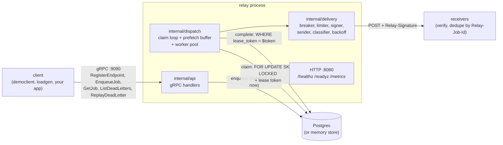

# relay

`relay` is a webhook delivery service written in Go. Clients register endpoints and enqueue jobs over gRPC, and relay delivers each job as an HMAC-signed HTTP POST. Delivery uses retries with jittered exponential backoff, per-endpoint rate limiting, a circuit breaker and a dead-letter queue. Delivery is at-least-once, and chaos tests show that no job is lost once `EnqueueJob` returns, even when dispatchers crash mid-delivery.



## Quickstart

The only requirement is Docker with Compose.

```sh
make up && make demo
```

`make up` builds one image and starts Postgres, relay, a healthy receiver, and a flaky receiver (`--fail-rate 0.3 --max-latency 500ms`). `make demo` registers one endpoint per receiver and enqueues 200 jobs, split evenly between them. The flaky endpoint uses `max_attempts=2`, so some of its jobs get dead-lettered. The demo then polls `GetJob` until every job settles and prints the receiver stats and relay's metrics. Here is the output of one run:

```text
registered healthy endpoint 93ff5519-ba6e-457e-9fd0-23a1afe807a6 -> http://receiver-healthy:8081/hook
registered flaky   endpoint 4ef5c0e9-1d39-4975-956a-503a4c912cdb -> http://receiver-flaky:8081/hook (max_attempts=2)
enqueued 200 jobs

13:04:04  delivered=0    (after retries=0)  retrying=200  dead=0
13:04:06  delivered=182  (after retries=17)  retrying=12   dead=6
13:04:08  delivered=190  (after retries=25)  retrying=0    dead=10

flaky    delivered=90   retried=25   retrying=0    dead=10
healthy  delivered=100  retried=0    retrying=0    dead=0

receiver stats:
  healthy: {"unique":100,"duplicates":0,"injected_failures":0,"rejected_signatures":0}
  flaky:   {"unique":90,"duplicates":0,"injected_failures":45,"rejected_signatures":0}

relay metrics (http://localhost:8080/metrics):
relay_deliveries_total{result="dead"} 10
relay_deliveries_total{result="delivered"} 190
relay_deliveries_total{result="retry"} 35
relay_jobs_enqueued_total 200
relay_queue_depth{status="dead"} 10
relay_queue_depth{status="delivered"} 190
relay_queue_depth{status="in_flight"} 0
relay_queue_depth{status="pending"} 0
```

The numbers reconcile. The flaky receiver injected 45 failures, and relay recorded 35 retries plus 10 dead letters. `make down` stops the stack and deletes its volume.

Without Docker, run `go run ./cmd/relay`, which falls back to the in-memory store, and use the other commands directly.

## Guarantees

- **At-least-once delivery.** Every job is delivered at least once unless it is dead-lettered. A job can be delivered more than once, so receivers must dedupe on the `Relay-Job-Id` header (`cmd/receiver` shows how).
- **Exactly-once delivery is not possible over HTTP.** The sender cannot tell an unprocessed request from a processed request whose response was lost. Examples: a timeout, a dropped connection, or a relay crash after the receiver committed but before relay recorded the result. In each case relay has two choices: retry, which risks a duplicate, or give up, which risks losing the job. relay always retries, so exactly-once *processing* has to come from the receiver deduplicating on a stable ID.
- **No ordering guarantee.** Jobs for one endpoint run in parallel, retry independently, and can be rescheduled by the breaker or rate limiter. Include a sequence number or timestamp in the payload if order matters.
- **A job is never lost once `EnqueueJob` returns**, with the Postgres store. The row is committed before the RPC returns. Every later state change is a conditional update, and a crashed worker's jobs come back when their lease expires (see below). The two chaos tests show this under crashes, and their results are in [Testing](#testing). The in-memory store has the same semantics within one process, but it does not survive a restart.

## Failure classification

| Response | Result |
|---|---|
| 2xx | delivered |
| 408, 429, 5xx, timeout, connection error | retry (on 429, honor `Retry-After` in seconds, capped at 10m) |
| any other 4xx, invalid URL | dead immediately |

Other rules:
- **Retries** wait `rand(0, min(cap, base·2^attempt))`: full jitter, base 1s, cap 10m, both configurable. A job is dead-lettered when it reaches its endpoint's `max_attempts`. `ReplayDeadLetter` resets its attempts and makes it due now.
- **Circuit breaker** (per endpoint, in-process): it opens after 5 consecutive retryable failures and stays open for 30s. It then lets one probe through, which closes it on success or reopens it on failure. A job that hits an open breaker is rescheduled to the end of the cooldown without counting an attempt. A permanent 4xx neither trips nor resets it.
- **Rate limiter**: a token bucket of `max_rps` per endpoint, in-process. A job that would wait more than 1s for a token is rescheduled without counting an attempt.

## Claiming, leases and lease tokens

Each poll claims a batch of due jobs in one transaction:

```sql
SELECT id FROM jobs
WHERE (status = 'pending'   AND next_attempt_at <= $now)
   OR (status = 'in_flight' AND locked_until    <  $now)   -- an expired lease
ORDER BY next_attempt_at
LIMIT $n
FOR UPDATE SKIP LOCKED;

UPDATE jobs j
SET status = 'in_flight', locked_until = $now + $lease, lease_token = c.token, updated_at = $now
FROM unnest($ids, $fresh_tokens) AS c(id, token), endpoints e
WHERE j.id = c.id AND e.id = j.endpoint_id
RETURNING j.*, e.*;
```

- **`SKIP LOCKED`** lets any number of dispatchers claim concurrently without blocking each other or claiming the same row.
- **The expired-lease condition** is what makes a crashed worker's jobs recoverable. If a process dies holding a lease, its jobs become claimable again once `locked_until` passes (30s by default).
- **A fresh `lease_token` per claim** guards against a slow worker. Every completion is conditional on the token from its own claim:

```sql
UPDATE jobs j SET status = ..., attempts = ..., lease_token = NULL, ...
WHERE j.id = $id AND j.status = 'in_flight' AND j.lease_token = $token_from_my_claim;
```

Suppose a worker's lease expires while its request is still running, and another worker reclaims the job. The slow worker's eventual write matches 0 rows, so it can't overwrite the newer result. relay logs that write as stale and drops it. The same statement decides retry versus dead from `max_attempts`, so that decision is atomic with the lease check.

## Load-test results

These numbers came from `make loadtest`, which runs `scripts/loadtest.sh`. The script starts relay with its default config, runs `cmd/loadgen` against the memory store, then repeats the run against Postgres 16 in Docker. `loadgen` receives the webhooks itself. Latency is measured from when `EnqueueJob` returns to when the webhook arrives. The runs used 512 B payloads spread over 4 endpoints. Postgres ran in a Colima VM (4 vCPU, 8 GB) on the same laptop.

**At 2,000 jobs/s** (`make loadtest`):

```text
== machine
Apple M2 Max, 12 cores, 96 GB RAM, macOS 26.6.2
go version go1.27.4 darwin/arm64

== memory store (RELAY_DATABASE_URL empty, default config)
$ ./bin/loadgen --addr 127.0.0.1:19090 --n 20000 --rate 2000
jobs=20000 target_rate=2000/s concurrency=32 payload=512B endpoints=4
enqueue:  20000 ok, 0 errors in 10s -> 2000 jobs/s
delivery: 20000 delivered (0 duplicate receipts) in 10.175s -> 1966 jobs/s end to end
enqueue->delivery latency: p50=101.1ms p90=181.2ms p99=198.8ms max=202.6ms

== postgres store (postgres:16-alpine in Docker, default config)
$ ./bin/loadgen --addr 127.0.0.1:19090 --n 20000 --rate 2000
jobs=20000 target_rate=2000/s concurrency=32 payload=512B endpoints=4
enqueue:  20000 ok, 0 errors in 10.004s -> 1999 jobs/s
delivery: 20000 delivered (0 duplicate receipts) in 10.03s -> 1994 jobs/s end to end
enqueue->delivery latency: p50=107.6ms p90=186.7ms p99=205.0ms max=213.2ms
```

**Saturation run** (`N=50000 RATE=10000 ./scripts/loadtest.sh`, same machine):

```text
== memory store (RELAY_DATABASE_URL empty, default config)
$ ./bin/loadgen --addr 127.0.0.1:19090 --n 50000 --rate 10000
jobs=50000 target_rate=10000/s concurrency=32 payload=512B endpoints=4
enqueue:  50000 ok, 0 errors in 5s -> 10000 jobs/s
delivery: 50000 delivered (0 duplicate receipts) in 5.165s -> 9681 jobs/s end to end
enqueue->delivery latency: p50=105.7ms p90=183.3ms p99=198.9ms max=201.6ms

== postgres store (postgres:16-alpine in Docker, default config)
$ ./bin/loadgen --addr 127.0.0.1:19090 --n 50000 --rate 10000
jobs=50000 target_rate=10000/s concurrency=32 payload=512B endpoints=4
enqueue:  50000 ok, 0 errors in 7.041s -> 7101 jobs/s
delivery: 50000 delivered (0 duplicate receipts) in 26.776s -> 1867 jobs/s end to end
enqueue->delivery latency: p50=10869.1ms p90=18228.0ms p99=19590.3ms max=19736.8ms
```

How to read these results:
- **Below capacity**, latency is set by the 200ms poll interval: about 100ms median, with a p99 just under 200ms.
- **Postgres** kept up with 2,000 jobs/s. On this setup, a single relay instance with the default 16 workers delivered about 1,870 jobs/s at saturation. Above that, a backlog builds and latency grows with it.
- **Two bugs fixed:** the load test found two dispatcher bugs before these numbers were recorded, and both now have regression tests. One was a poll loop that throttled to one claim per tick. The other was HTTP connections not being reused, which exhausted ports and tripped breakers. See `DECISIONS.md`.

## Testing

| Command | What it runs |
|---|---|
| `make test` | `go vet` plus `go test -race ./...`. It needs no Docker and no network. Without Docker, the Postgres tests skip with a message saying why. |
| `make chaos` | Both chaos tests (build tag `chaos`) on the memory store. Use `RELAY_TEST_PG=1 make chaos` for Postgres. |
| `make cover` | Coverage of `internal/store`, `internal/delivery` and `internal/dispatch`, which fails below 80%. |
| `make lint` | `golangci-lint` (see `.golangci.yml`). |

Results:
- **Shared contract suite** (`internal/store/storetest`): runs against both stores. It covers idempotent enqueue, claiming only due jobs, 8 concurrent claimers on 500 jobs with no overlap, reclaim after lease expiry, the stale-completion guard, retries, dead-lettering, pagination and replay.
- **Store chaos test**: 5,000 jobs and 8 workers with 200ms leases. Workers complete 60% of claims, retry 25%, and abandon 15% to simulate a crash. 5% of completions oversleep their lease. Postgres run (`RELAY_TEST_PG=1 make chaos`): `elapsed=4.503s delivered=4992 dead=8 lost=0 ... stale_rejected(provable)=348/348`.
- **End-to-end chaos test**: 2,000 jobs, a receiver failing 30% of requests, and 3 dispatchers, with a random one crashed every 500ms without graceful shutdown. Memory run: `elapsed=4.51s delivered=2000 dead=0 lost=0 kills=9 requests=2908 duplicate_receipts=0`. Postgres run: `elapsed=5.418s delivered=2000 dead=0 lost=0 kills=9`. Other runs saw duplicate rates of 0.00–0.40%, which at-least-once delivery allows.
- **Coverage** (`make cover`): 86.2% with Docker available, so the Postgres store is exercised. It is 69.7% without Docker, because the Postgres package can't run.
- **Colima users:** testcontainers needs `DOCKER_HOST=unix://$HOME/.colima/default/docker.sock` and `TESTCONTAINERS_DOCKER_SOCKET_OVERRIDE=/var/run/docker.sock`. To use an existing server instead, set `RELAY_TEST_DATABASE_URL`.

## Configuration

Every setting comes from the environment and is validated at startup.

| Variable | Default | Meaning |
|---|---|---|
| `RELAY_GRPC_ADDR` | `:9090` | gRPC listen address |
| `RELAY_HTTP_ADDR` | `:8080` | `/healthz`, `/readyz` (store reachable), `/metrics` |
| `RELAY_DATABASE_URL` | *(empty)* | Postgres URL; empty means the in-memory store |
| `RELAY_LOG_LEVEL` | `info` | `debug`, `info`, `warn`, `error` (JSON logs via `log/slog`) |
| `RELAY_WORKERS` | `16` | concurrent deliveries per instance |
| `RELAY_BATCH_SIZE` | `32` | max jobs per claim (prefetch buffer size) |
| `RELAY_POLL_INTERVAL` | `200ms` | poll interval when the queue is not saturated |
| `RELAY_LEASE` | `30s` | how long a claim is held before another worker may reclaim it |
| `RELAY_REQUEST_TIMEOUT` | `10s` | per-request timeout; must be less than the lease |
| `RELAY_BACKOFF_BASE` / `RELAY_BACKOFF_CAP` | `1s` / `10m` | retry backoff |
| `RELAY_BREAKER_THRESHOLD` / `RELAY_BREAKER_COOLDOWN` | `5` / `30s` | circuit breaker |
| `RELAY_SHUTDOWN_TIMEOUT` | `15s` | graceful-shutdown wait for in-flight deliveries |
| `RELAY_METRICS_INTERVAL` | `5s` | `relay_queue_depth` refresh interval |

Metrics: `relay_jobs_enqueued_total`, `relay_deliveries_total{result="delivered|retry|dead"}`, `relay_delivery_duration_seconds`, `relay_queue_depth{status}`, `relay_breaker_open{endpoint_id}`.

When relay gets SIGINT or SIGTERM, it shuts down in this order:
1. Stops accepting RPCs.
2. Stops claiming jobs, and releases buffered jobs that haven't started.
3. Gives in-flight deliveries up to 15s to finish.
4. Releases the leases on anything still running, as pending and due now, without counting an attempt.

## Known limitations

- **Plaintext secrets.** Endpoint signing secrets are stored unencrypted in `endpoints.secret`.
- **In-process limiter and breaker.** The rate limiter and circuit breaker are per process. With N instances, an endpoint can receive up to N × `max_rps`, and each instance trips its breaker independently. A multi-instance deployment needs a shared limiter (for example Redis or Postgres).
- **No retention of delivered jobs.** `delivered` and `dead` rows are kept forever, so the `jobs` table grows without bound.
- **No SSRF protection on endpoint URLs.** Any `http`/`https` URL is accepted, including internal addresses such as `http://169.254.169.254/` or `http://localhost`. Do not expose `RegisterEndpoint` to untrusted clients as-is.
- **Leases are held briefly for buffered jobs.** With very slow receivers, a job can wait in the prefetch buffer long enough to approach its lease. The lease token keeps that safe, but it can cause a duplicate delivery.
- **The in-memory store is not durable.** It exists for tests and local runs.

## Next steps

- **Outbox pattern:** let applications write jobs into their own database transaction and have relay pick them up, so enqueueing is atomic with the business change.
- **Shared rate limiter** (and optionally a shared breaker state), so limits hold across instances.
- **Sharded dispatch:** partition claiming by endpoint or by hash, so many instances don't contend on the same index range, and so per-endpoint ordering becomes possible.
- **Retention job:** delete or archive `delivered` and old `dead` rows after a configurable period.

## Layout

```
cmd/relay         server: gRPC :9090, HTTP :8080 (/healthz, /readyz, /metrics)
cmd/receiver      demo receiver: verifies signatures, dedupes by job ID, --fail-rate, --max-latency
cmd/loadgen       enqueues N jobs at a target rate, reports throughput and latency percentiles
cmd/democlient    registers endpoints and enqueues jobs for the demo
internal/config   env config, defaults, validation
internal/store    Store interface + postgres/ + memory/ + shared contract suite (storetest/)
internal/delivery signer, sender, failure classifier, backoff, breaker, limiter registry
internal/dispatch dispatcher, worker pool, retry policy
internal/api      gRPC handlers, HTTP probes
internal/metrics  Prometheus metrics
internal/clock    injectable clock
proto/relay/v1    relay.proto (generated code is committed under gen/)
test/chaos        store-level and end-to-end chaos tests (build tag: chaos)
```

Design decisions and the alternatives rejected are listed one per line in `DECISIONS.md`. Build progress is tracked in `PROGRESS.md`.

## License

MIT
